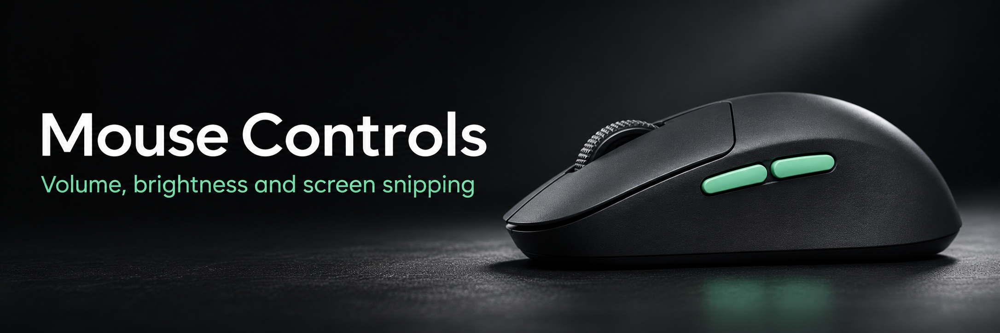
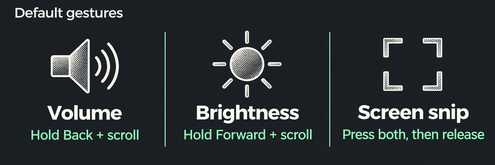

# Mouse Controls

A small C# tray app for Windows laptops. Hold either mouse side button and scroll to adjust volume or screen brightness. Press both together to open Windows screen snipping.



## Getting started

Run **MouseControls.exe** and choose an action for each side button. Changes apply immediately. Close the window to keep the gestures running. Click the mouse icon in the notification area to reopen settings, or right-click it and choose **Exit** to quit.

| Gesture | Default action |
| --- | --- |
| Hold Back and scroll | Adjust system volume |
| Hold Forward and scroll | Adjust laptop screen brightness in steps of five percentage points |
| Press both buttons within 300 ms | Open Snipping Tool to select an area |
| Tap either button on its own | Send the usual Back or Forward click |

Either button can control volume or brightness. Set **Both buttons** to **Off** to disable screen snipping.



## Requirements

A Windows laptop with .NET Framework 4.x and a mouse whose side buttons report Back and Forward. Brightness requires a laptop panel driver that exposes Windows brightness control. The native brightness flyout targets Windows 11 and can vary by build.

## Build from source

Exit the running app from the tray menu, then run the following from the project directory in PowerShell. The build uses the .NET Framework compiler installed with Windows and embeds the mouse icon in the executable.

```powershell
.\build.cmd
.\MouseControls.exe
```

See the [implementation guide](HOW-IT-WORKS.md) for the input handling, Windows APIs and settings format.
